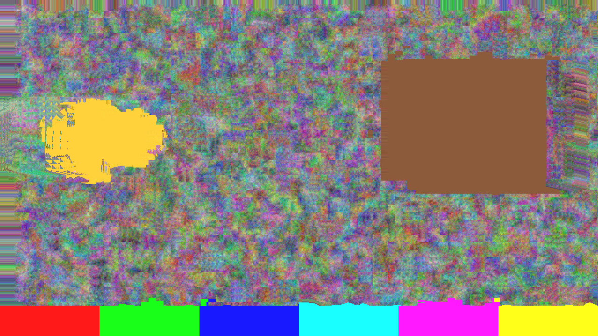
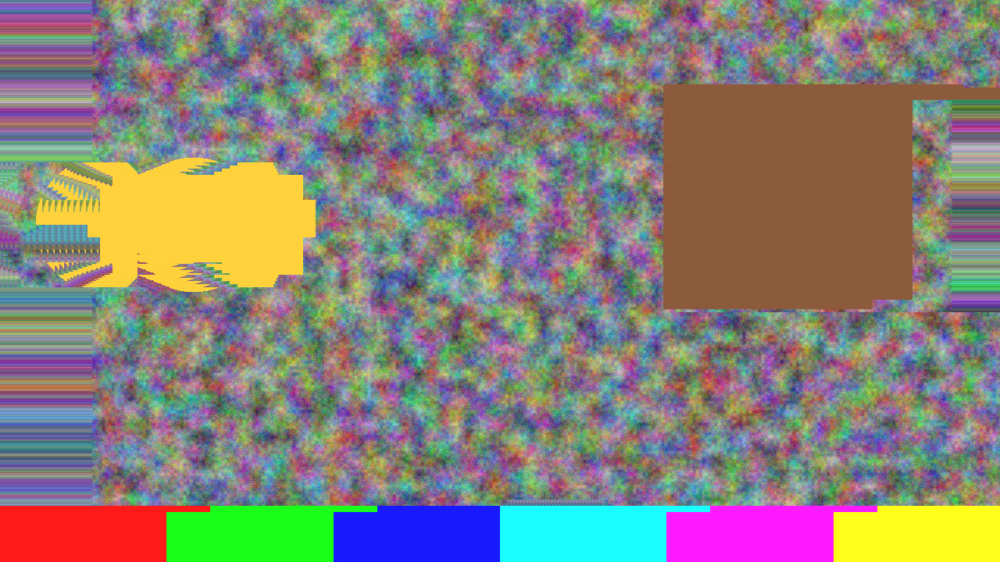
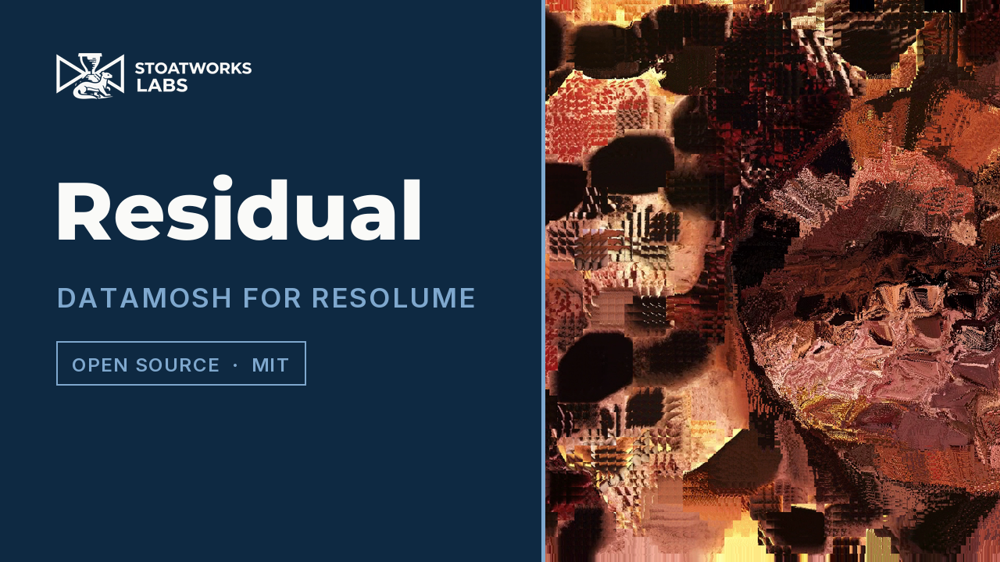

# Residual

> **AI-assisted project.** This codebase was created with [Claude](https://claude.com/claude-code)
> (Anthropic), directed and reviewed by a human author. The claims here are measured, not just
> asserted, by an offline harness that drives the real plugin code, and most of them are bitwise.
> **It has never been loaded into Resolume on macOS.** On Windows, a build of v0.1.0 loads,
> registers and renders in Resolume Arena 7.27.1 with every control as declared, on software
> rendering. What's been measured, and how, is under [Status](#status).

Datamosh for Resolume Arena and Avenue, built as a working video codec so that it can go wrong
properly.

Datamosh is a video decoder doing its job perfectly well with the wrong information. A
P-frame is a field of motion vectors plus a residual (the correction), applied to the last
frame the decoder reconstructed. Take away the I-frame at a scene cut and the decoder keeps
painting the *old* picture with the *new* scene's motion. Take away the residual and nothing
ever corrects it. Repeat one frame's vectors and the pixels keep flowing in that direction.
That's the bloom.

So this is the codec (a block-matching motion estimator, closed-loop prediction from the
decoder's own reconstructed frame, a quantised 8×8 DCT residual and a GOP), plus controls
that each break one piece of it, so every datamosh look is a named failure of a named stage.

The demo card through the plugin, rendered by its own offline harness (`rstest --out`)
rather than captured from Resolume. The card cut to a different scene sixteen frames earlier.
With the I-frame dropped and nothing added back, the decoder's been block-copying the old
picture along the new picture's motion vectors ever since, and they've smeared the yellow
disc.

<!-- downloads:start -->

## Download

**[v0.1.0](https://github.com/stoatworks-labs/residual/releases/tag/v0.1.0)** — prebuilt for macOS and Windows. Pick your platform:

<b>macOS</b> — Universal (Apple Silicon + Intel)

| Build | Download | Size |
| --- | --- | --- |
| Universal (Apple Silicon + Intel) · .dmg disk image | [`residual-0.1.0-macos-universal.dmg`](https://github.com/stoatworks-labs/residual/releases/download/v0.1.0/residual-0.1.0-macos-universal.dmg) | 236 KB |
| Universal (Apple Silicon + Intel) · .zip archive | [`residual-macos-universal.zip`](https://github.com/stoatworks-labs/residual/releases/latest/download/residual-macos-universal.zip) | 196 KB |

<b>Windows</b> — x64

| Build | Download | Size |
| --- | --- | --- |
| x64 · .exe installer | [`residual-0.1.0-windows-x86_64-setup.exe`](https://github.com/stoatworks-labs/residual/releases/download/v0.1.0/residual-0.1.0-windows-x86_64-setup.exe) | 223 KB |
| x64 · .zip archive | [`residual-windows-x86_64.zip`](https://github.com/stoatworks-labs/residual/releases/latest/download/residual-windows-x86_64.zip) | 116 KB |

All builds, checksums and release notes: [github.com/stoatworks-labs/residual/releases](https://github.com/stoatworks-labs/residual/releases).

macOS builds are signed and notarised and open normally. The Windows builds are unsigned, so SmartScreen warns once.

<!-- downloads:end -->

## What falls out of it

None of this is drawn. There's one decoder loop, `decoded = prediction + residual`, where
the prediction is the last decoded frame moved by the vectors, and these are what happen
when you take one term of it away:

- **Drop I**: the I-frame at a scene cut never arrives, so the decoder carries on
  predicting the new scene from the old picture. The classic mosh.
- **Residual Gain at zero**: nothing ever corrects the prediction. The picture is pure
  motion, and whatever was on screen flows wherever the vectors say.
- **Vector Hold**: one frame's vectors are reused for the next N. The pixels keep
  travelling the way they were going. That's the bloom.
- **Vector Scale**: the vectors are multiplied. Everything moves too far, or (at 0) not at all.
- **Q**: the residual is quantised harder. You get blocks, and a closed loop that slowly
  loses the picture between I-frames.
- **Refresh**: one I-frame, now. The operator's get-out-of-jail button, and it works
  whatever Drop I says.

Vector Hold at 30 frames and Vector Scale at 2. The estimator found the disc moving
once, and the decoder's been applying that motion, doubled, ever since.

*[Watch it](https://www.youtube.com/watch?v=2KrF01zB9mA) (50 seconds): the old picture carried
on by the new clip's motion when the I-frame is dropped at a cut, Refresh cleaning it up, the
bloom from held and stretched vectors, a mosh healing at a Residual Gain just above zero, hard
quantisation drifting until the next I-frame, and the vector field itself. It's all the
plugin's own output. An FFGL plugin doesn't have a window to film, so the footage comes from
this repo's own offline harness (`rstest --pipe`, driven by a cue sheet) rather than a screen
recording, and the clips are Resolume's bundled demo media.*

## Try it in your browser

**<https://residual-demo.stoatworks-labs.com>**

It isn't the plugin, but it is the whole codec, from the plugin's own GLSL: the fifteen
shader pieces in `source/Shaders.cpp`, copied across unedited and assembled the same way
`shaders::assemble()` does it, running every pass in WebGL2 (motion search at every pyramid
level, prediction, the four DCT passes and the reconstruction). The small CPU half (the
frame-type decision, the Drop I latch, Vector Hold, the search schedule) is a hand port that
nothing checks except a person reading it. `demo/tools/check_shaders.py`, run by
`tools/verify.sh`, fails if a single character of the shaders drifts. There's no audio in a
browser, so Drop I's On Onset never arms there, and because the generated clips never cut,
the page cuts to colour bars every three seconds on its own (a switch in its transport turns
that off). The page lists every difference at the bottom.

## Controls

**Encoder**: the codec as an encoder would build it.

- **Block Size**: 8, 16 or 32 pixels. The motion block; the residual is always 8×8.
- **Search Range**: ±1 to ±32 pixels, searched hierarchically on a luma pyramid.
- **Half Pel**: refine each vector to half a pixel, with the codec's rounded averages.
- **GOP**: an I-frame every N frames, 1 to 250.
- **Scene Cut**: insert an I-frame where the motion-compensated difference says the
  picture changed, as encoders do.
- **Scene Threshold**: how large that difference has to be, 2 to 64 codes per pixel.

**Residual**: what gets added back.

- **Q**: the luma quantiser. 0 is a true bypass and the codec is lossless; above it the
  step runs from 2 to 512.
- **Residual Gain**: what the dequantised residual is multiplied by before it's added
  back. 1.0 is honest; 0 is a decoder that never corrects. I-frames always reconstruct
  at unity.
- **Chroma Q**: the quantiser for Co and Cg.

**Mosh**: the breaks.

- **Drop I**: Off, Next (the next I-frame, once), All, or On Onset (an audio onset
  arms it).
- **Vector Hold**: reuse one frame's vectors for 1 to 60 frames.
- **Vector Scale**: 0 to 4×, in half-pel units.
- **Refresh**: force one I-frame.
- **Audio**: Resolume's 64-bin spectrum, for On Onset. The detector is primed on the
  first frame, so a clip trigger doesn't read as a hit.

**View**

- **Show Vectors**: draw the vector field over the picture.
- **Mix**: crossfade with the untouched clip.

## How it works

Per frame:

1. **Copy** the host's texture into an 8-bit integer texture, exactly, and take the
   codec's own luma from it (YCoCg-R's Y). Build a luma pyramid.
2. **Search.** From the coarsest level down, one fragment per (block, candidate)
   computes a sum of absolute differences against the *previous source frame*, and one
   fragment per block keeps the best. Equal SADs prefer the smaller vector, zero first,
   so a flat block always comes out as (0, 0). Level 0 can refine to half a pixel.
3. **Decide I or P** from the GOP, the scene-cut difference, the Refresh trigger and the
   Drop I latch. A frame with nothing to predict from (the first, or the one after a
   resize) is an I-frame whatever Drop I says.
4. **Predict**: the last *decoded* frame block-copied by the vectors. A whole-pel vector is
   one texel fetch; a half-pel one is the codec's `(a + b + 1) >> 1`.
5. **Residual**: source minus prediction, in Y/Co/Cg, through a separable 8×8 DCT,
   quantised at Q and Chroma Q, back again, scaled by Residual Gain, rounded, added to the
   prediction, clamped. That's the decoded frame, and it's the next frame's reference.
6. **Composite** the decoded frame (or a mix) to the host.

Everything the decoder keeps is an integer texture read with `texelFetch`, so there's no
filtering anywhere in the loop and no float-to-fixed conversion between a shader and a
byte. That's what lets the harness make bitwise claims. The colour transform is YCoCg-R,
the reversible integer form: an 8-bit RGB triple goes to Y in 0..255 and Co, Cg in
−255..255 and comes back unchanged, for all 16,777,216 of them, which is why "Q 0 is
lossless" is a bitwise claim rather than a tolerance.

## Status

**v0.1.0, 2026-09-23, and still early days.**

- **It has never been loaded into Resolume on macOS.** Everything numeric here was
  compiled, rendered and measured offline against the real plugin class in a headless GL
  context, plus one load in the fleet's own [oxbow](https://github.com/stoatworks-labs/oxbow)
  host, which confirms it registers, instantiates and renders as `SW Residual` / `RS01`
  / effect.
- **Windows, in Resolume Arena 7.27.1** (win-lab, Mesa llvmpipe, no GPU, 2026-09-23): a
  CI build of this source loads from Extra Effects and registers as `SW Residual` / `RS01`
  / effect, all 22 host controls match the declaration in name, order, type, range and
  default, it renders, and Arena's log stays clean. That's 8 of 9 of the fleet gate's
  checks. The ninth, controls, read Search Range, Half Pel, Scene Cut, Scene Threshold and
  Drop I as dead, because the gate holds a still picture, and a codec's motion search and
  scene-cut detector have nothing to find in one: no motion and no cut. `tools/sweep.py`,
  which feeds in moving pictures and cuts, shows all five are live. Software rendering says
  nothing about a GPU or about speed.
- 296 assertions across nine check suites, all passing (`tools/verify.sh`), locally and
  in CI on GitHub's GPU-less macOS runner. Every tolerance is a lattice (one code value,
  one block, or none at all), and seven negative controls prove the checks can fail. Change
  one character in the shipped predict shader and `--mosh` fails in all six cases. The
  audit of every check is in `AGENTS.md`.
- **The headline results.** With the I-frame dropped and the residual at zero, the decoded
  frame after a hard cut **is** the previous decoded frame block-copied by the vectors the
  estimator produced, with 0 of 2,592,000 samples differing across six cases at two rasters
  (`rstest --mosh`). At Q 0 the codec is lossless, 0 of 49,766,400 samples differing
  (`--lossless`). A texture translated by (dx, dy) returns exactly (dx, dy) from every one
  of 29,961 interior blocks over 63 cases (`--vectors`). An I-frame is bitwise a function of
  its source alone (`--gop`). Closed-loop drift grows by exactly one code a frame for 31
  frames under the quantiser's dead zone (`--drift`). Seven deliberate perturbations of the
  model are asserted to make those checks *fail* (`--negative`). All fourteen sweepable
  controls are proven to change the picture (`tools/sweep.py`), and the bundle registers,
  instantiates and renders 120 frames in the fleet's `oxbow` host.
- Measured on macOS (Apple Silicon) at the defaults (16-pixel blocks, ±16 search,
  three pyramid levels): **5.1 ms/frame at 720p, 6.1 at 1080p, 14.0 at 4K**, of which the
  one-integer scene-cut readback (a CPU–GPU synchronisation) is roughly 1 ms. The motion
  search is where the time goes, and it scales with the search: 8-pixel blocks at ±32 run
  at about 50 ms a frame at every raster, which isn't a setting for a show. It's never
  been timed on Windows, on Intel (where it's never run), or on a rasteriser without a GPU
  behind it.
- **Chroma is coded at full resolution.** Co and Cg get their own quantiser but aren't
  subsampled to 4:2:0, so the chroma-block look of a real mosh isn't here yet.
- **The scene-cut detector only judges frames whose vectors are fresh.** Under Vector
  Hold, held vectors carry the SAD of the frame they were found on, which says nothing
  about this one.
- **Alpha isn't coded.** The decoded frame carries the current source's alpha through.
- No factory presets. No OpenFX port (not required for 0.1.0). The
  [browser demo](https://residual-demo.stoatworks-labs.com) runs the whole codec from the
  plugin's own shaders, but its small CPU half is a hand port only a reader checks.
- The user guide is [docs/USER-GUIDE.md](docs/USER-GUIDE.md); the About block's fourth
  button opens it.

## Installing

Copy `Residual.bundle` (macOS) or `Residual.dll` (Windows) into

    ~/Documents/Resolume Arena/Extra Effects        (or "Resolume Avenue")
    Documents\Resolume Arena\Extra Effects           (Windows)

and restart Resolume. It shows up under **Effects** as **SW Residual**.

## Building

    git clone --recursive https://github.com/stoatworks-labs/residual
    cmake -B build -DCMAKE_BUILD_TYPE=Release
    cmake --build build --parallel
    cmake --install build          # into Arena's Extra Effects, macOS

C++17 + GLSL 4.10, CMake, FFGL 2.1 (SDK vendored as a submodule, pinned to `b1afaf9`). The
macOS build is universal (arm64 + x86_64) by default; add `-DCMAKE_OSX_ARCHITECTURES=arm64`
for a faster development build. Windows needs GLEW from vcpkg, and
`.github/workflows/release.yml` has the exact configure line.

## Building and testing

The offline harness renders the real plugin class headless and measures it:

    ./build/rstest --out /tmp/f.png --size 1920x1080 --frames 40 --set "Drop I=2" --set "Residual Gain=0"
    ./build/rstest --list                                           # every control and its range
    ./build/rstest --transform                                      # the arithmetic; no GL at all
    ./build/rstest --vectors --lossless --mosh --gop                 # the bitwise claims
    ./build/rstest --drift --resize --onset                          # the codec's behaviour over time
    ./build/rstest --negative                                       # those checks, perturbed, must fail
    ./build/rstest --bench --frames 60                              # 720p through 4K
    ffmpeg -i in.mov -f rawvideo -pix_fmt rgba - \
      | ./build/rstest --pipe --size 1920x1080 --fps 30 --script cues.txt \
      | ffmpeg -f rawvideo -pix_fmt rgba -s 1920x1080 -r 30 -i - out.mp4   # footage through it
    python3 tools/sweep.py                                          # no control is silently dead
    tools/verify.sh                                                 # all of it, on a fresh universal build

`tools/verify.sh` does the release job's work locally (universal build, `lipo`, the plist,
the exact `codesign` the release runs, and a real host load), so a problem turns up before
the tag rather than after it.

## Diagnostics

Residual writes a plain-text log every time it runs:

    ~/Library/Logs/residual/residual.YYYY-MM-DD.log                     (macOS)
    %LOCALAPPDATA%\residual\logs\residual.YYYY-MM-DD.log                (Windows)

It records the build, the GL driver, any shader that wouldn't compile, every resize (which
restarts the GOP with an I-frame), and at frame 60 the host's clock, the block grid and the
motion-compensated difference. If you're filing a bug, it's the most useful thing you can
attach.

<!-- attributions:start -->
This project is built on other people's work — see [ATTRIBUTIONS.md](ATTRIBUTIONS.md).
<!-- attributions:end -->

## Licence

MIT — see [LICENSE](LICENSE).
